

  

# Manual do FlyController

**Conteúdo:** [Introdução](#introdução) · [Operação do controlador](#operação-do-controlador) · [O Fly App](#o-fly-app) · [Painel de voo](#painel-de-voo) · [Configurações](#configurações)

## Introdução

O Fly Controller é um controlador eletrônico para paramotores elétricos, baseado no microcontrolador ESP32-C3. Ele lê o acelerador, comanda o ESC e aplica proteções automáticas. O acompanhamento do voo, a configuração, os registros de voo e a atualização de firmware são feitos pelo app **Fly App**, por Bluetooth.

Principais funções:

- Leitura do acelerador (sensor Hall) e controle do ESC, por PWM ou CAN, conforme o modelo do controlador (XAG ou T-Motor).
- Limitação automática de potência pela tensão da bateria e pelas temperaturas do motor e do ESC.
- Carga da bateria por contagem de corrente (coulomb counting) e, opcionalmente, integração com um BMS Bluetooth (JBD, Daly ou JK).
- Estimativa do tempo de motor restante.
- Alertas sonoros no buzzer para calibração, armamento, falhas e redução de potência.
- Painel de voo, configuração, registros e atualização de firmware pelo Fly App, via Bluetooth.
- Acelerador sem fio opcional, via ESP-NOW.

O controlador não tem mais rede Wi-Fi própria nem portal web. Tudo o que antes era feito pelo navegador em 192.168.4.1 agora é feito pelo Fly App.

Este manual foi elaborado com base no firmware 2026-10-12.1 e no Fly App 2026-10-12.1.

## Operação do controlador

### Ligar o sistema

1. Conecte a bateria ao controlador, respeitando a polaridade indicada no equipamento.
2. O controlador inicia sozinho e o buzzer emite um beep de partida.
3. O acelerador ainda não está calibrado. Calibre antes de armar.

### Calibrar o acelerador

A calibração define o mínimo e o máximo do curso do acelerador e precisa ser feita toda vez que o sistema é ligado.

1. Leve o acelerador à posição máxima e mantenha por 3 segundos. O buzzer emite três beeps curtos: o máximo foi memorizado.
2. Leve o acelerador à posição mínima e mantenha por 3 segundos. O buzzer toca a melodia de calibração concluída.

Se você soltar o acelerador antes dos 3 segundos, aquele passo é cancelado. Basta repeti-lo.

### Armar e desarmar

**Armar** libera a potência para o motor: o acelerador passa a comandar o ESC. **Desarmar** corta a potência e deixa o sistema em modo seguro.

Para armar:

1. Confirme que a calibração foi concluída.
2. Deixe o acelerador na posição mínima (0 %).
3. Dê um toque curto no botão. Um bip confirma.
4. Em até meio segundo, aperte de novo e mantenha pressionado por 2 segundos. Um tom sobe enquanto carrega e, ao completar, o sistema arma.
5. Armado, o sistema emite bips enquanto o motor estiver parado, avisando que está pronto para acelerar.

Se você soltar o botão antes dos 2 segundos, o armamento é cancelado. Recomece pelo toque curto.

Para desarmar:

- **Com o acelerador fechado:** aperte o botão. O sistema desarma na hora.
- **Com o motor acelerado:** mantenha o botão pressionado. A potência cai até zero em 2 segundos, com um tom que desce, e o sistema desarma. Se você soltar antes, a potência volta aos poucos, também em 2 segundos, e o sistema continua armado.

Ao desarmar pelo botão, o buzzer toca a melodia de desarmado e o motor deixa de receber comando. Com o acelerador sem fio, os mesmos gestos valem para o botão do remote.

### Quando o sistema não arma

O sistema só arma com o acelerador em zero. Se você tentar armar acelerado, ele não arma e o buzzer toca um alerta (três tons repetidos). Solte o acelerador por completo e tente de novo.

Se você tentar armar acelerado pela terceira vez, o sistema apaga a calibração. Será preciso calibrar de novo antes de armar.

### Alerta de motor parado

Com o sistema armado e o motor parado, o buzzer emite um alerta contínuo (dois tons alternados). Ele para quando você acelera ou desarma.

### Desarme automático por falha

O sistema desarma sozinho quando a leitura do acelerador ou da tensão da bateria deixa de ser confiável:

- **Acelerador com fio:** leitura fora da faixa calibrada (cabo do sensor Hall rompido ou solto) ou falha de comunicação com o ADS1115 desarma imediatamente.
- **Acelerador sem fio (remote):** com meio segundo sem sinal, a potência vai a zero e o buzzer bipa a cada meio segundo, mas o sistema continua armado. Se o sinal voltar estável, a potência volta. Com 3 segundos sem sinal, o sistema desarma.
- **Tensão da bateria:** se o sensor estava válido ao armar e fica inválido por 2 segundos seguidos durante o voo, o sistema desarma. Falhas mais curtas são ignoradas.

Nos três casos o buzzer toca um alarme contínuo, mais rápido e agudo que o beep de desarme manual. Ele para quando você arma de novo, ou sozinho depois de 1 minuto. O Fly App mostra o código da falha em vermelho na barra de status até o próximo armamento (veja Painel de voo). Corrija a causa antes de armar de novo.

Se o sensor de tensão já estiver inválido no momento de armar, o sistema arma, mas a proteção da bateria fica desligada durante todo o voo.

### Controle de potência pelos sensores

O controlador reduz a potência máxima com base em três fontes: tensão da bateria, temperatura do motor e temperatura do ESC. Vale o limite mais restritivo dos três. Você pode abrir o acelerador todo, mas o ESC recebe no máximo o teto permitido.

- **Bateria:** abaixo da tensão mínima configurada, a potência é reduzida progressivamente. Ao armar, o piso de potência da bateria é reajustado.
- **Motor:** entre a temperatura de início de redução e a temperatura máxima, a potência cai de forma linear. A temperatura vem do CAN (T-Motor) ou do sensor NTC.
- **ESC:** igual ao motor, com os limites do ESC. A temperatura vem do CAN (T-Motor) ou do sensor analógico (XAG).

Os limites são configurados no Fly App (veja Configurações).

**ESC T-Motor recém-instalado sem temperatura no app:** o controlador configura o ESC para reportar a temperatura pelo CAN poucos segundos depois de detectá-lo, mas a configuração só vale depois que o próprio ESC é desligado e religado. Reiniciar só o Fly Controller não basta.

### Sensor de temperatura perdido

A perda de um sensor de temperatura nunca corta o motor. Sem leitura confiável do motor ou do ESC, o sistema:

- para de limitar a potência por aquele sensor;
- depois de 2 segundos sem o sensor, toca o alarme de proteção de temperatura desligada: duas notas descendentes, uma aguda curta e uma grave longa. O remote toca o seu alerta;
- repete o alarme aos 10 s, 30 s e 60 s, e depois a cada minuto, enquanto o sensor continuar fora;
- quando todos os sensores voltam por 2 segundos seguidos, toca duas notas ascendentes curtas e a limitação volta a funcionar.

O alarme só toca com o sistema armado. Em controladores T-Motor, só a fonte configurada (CAN ou NTC) é usada para limitar: se o CAN cair, o app pode mostrar a temperatura do NTC, mas ela não limita a potência. Ao ouvir o alarme, reduza a potência e considere pousar.

### Tempo de voo restante

O controlador estima quantos minutos de motor ainda restam no ritmo atual e envia o número ao Fly App, ao XCTrack e ao registro de voo, a cada 10 segundos.

- No chão, a estimativa usa o consumo de referência (de fábrica, 90 A no T-Motor e 75 A no XAG).
- Em voo, usa o consumo médio, que reage em cerca de 2 minutos. Na decolagem o número cai; no cruzeiro, melhora.
- Planando com o motor parado, a média fica congelada e o número quase não muda.
- Depois de cada voo com pelo menos 3 minutos de motor e corrente medida o tempo todo, o consumo de referência é ajustado em direção à média daquele voo.
- Sem medição de corrente (XAG sem BMS, ou se a corrente cair em voo), a estimativa usa a tensão da bateria e fica aproximada. O app indica esse modo.

O número é tempo de motor ligado. Com planeios, o voo dura mais do que ele mostra.

## O Fly App

O Fly App é a interface do Fly Controller. Ele mostra o painel de voo e é por ele que se configura o controlador, se baixam os registros e se atualiza o firmware. A conexão é por Bluetooth, direto com o controlador. Desconectar ou fechar o app não desliga o motor.

### Onde usar

| Aparelho | Como usar |
|---|---|
| **Android** | App instalado: baixe o arquivo APK na página de versões do Fly App e instale. Também funciona pelo navegador Chrome. |
| **iPhone e iPad** | Pelo navegador Bluefy, gratuito na App Store, no endereço do app web. O Safari não acessa Bluetooth e não há app instalável para iPhone. |
| **Computador** | Chrome ou Edge, no endereço do app web. |

Endereço do app web: [https://rodrigomedeirosbrazil.github.io/fly-app/](https://rodrigomedeirosbrazil.github.io/fly-app/) (mantenha a barra no final).

APK para Android: [https://github.com/rodrigomedeirosbrazil/fly-app/releases](https://github.com/rodrigomedeirosbrazil/fly-app/releases)

- **Android:** na primeira instalação, permita que o navegador ou o gerenciador de arquivos instale apps. Uma versão nova é instalada por cima da anterior, sem perder as preferências. Na primeira conexão o Android pede permissão de Bluetooth (e de localização, até o Android 11).
- **iPhone:** instale o [Bluefy](https://apps.apple.com/app/bluefy-web-ble-browser/id1492822055) e digite ou cole o endereço do app web dentro dele. Tocar no link fora do Bluefy abre o Safari, que não consegue falar com o controlador.
- **Firefox e Safari** não funcionam, em nenhum aparelho.

### Conectar ao controlador

1. Ligue o controlador.
2. Abra o Fly App e toque em **Conectar**.
3. No navegador (Bluefy, Chrome ou Edge), escolha **FlyController** na lista que aparece.
4. O app mostra o andamento: Procurando o controlador…, Conectando…, Aguardando telemetria…. Quando o primeiro dado chega, abre o painel de voo.

   
  <em>Figura 1: Tela inicial, com o botão Conectar</em>

  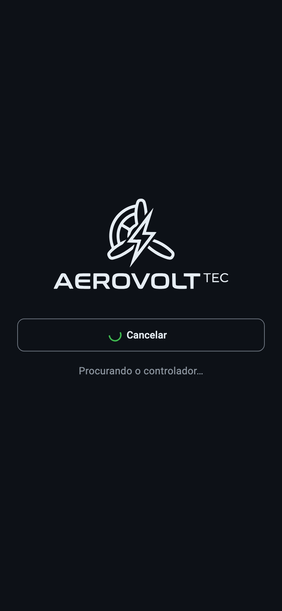 
  <em>Figura 2: Procurando o controlador</em>

Enquanto tenta, o botão vira **Cancelar**. O app continua tentando até encontrar o controlador, então você pode tocar em Conectar antes de ligá-lo.

Mensagens em vermelho indicam algo a corrigir no aparelho: **Bluetooth desligado**, **Permissão de Bluetooth negada** (com o botão Abrir Ajustes) ou **Localização desligada** (com o botão Abrir Localização, em Androids antigos).

Se aparecer "N quadros descartados" sem o painel abrir, o app está recebendo dados que não consegue ler. Desligue e ligue o controlador e conecte de novo.

No Android, quando há uma versão nova do app, a tela inicial mostra "Nova versão … toque para baixar" no rodapé.

### Diferenças da versão no navegador

- **Atualização de firmware:** a versão web não baixa o firmware do GitHub. Baixe o arquivo .bin do seu controlador (T-Motor ou XAG) na [página de versões do fly-controller](https://github.com/rodrigomedeirosbrazil/fly-controller/releases) e escolha-o em Escolher arquivo .bin.
- **Registros de voo:** depois de baixar um registro, escolha Compartilhar, Salvar arquivo ou Abrir. Abrir mostra o CSV numa aba nova, de onde dá para copiar o conteúdo.
- **Sem internet no local de voo:** abra o endereço uma vez com internet e espere cerca de 30 segundos. Depois disso o Chrome abre o app mesmo sem sinal. No Bluefy isso pode não funcionar, então abra o app antes de sair de onde há sinal.
- **Orientação da tela:** a opção não existe na versão web.
- A versão web é sempre a mais recente; não há aviso de atualização.

## Painel de voo

O painel é atualizado a cada segundo e mantém a tela acesa. Os cartões ficam sempre no mesmo lugar: nenhum aviso aparece, some ou empurra o resto da tela.

  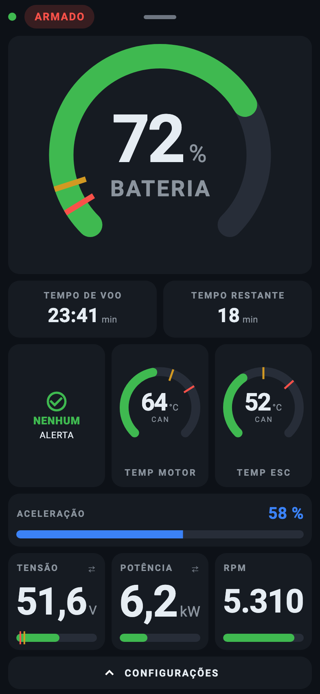 
  <em>Figura 3: Painel de voo, armado e em cruzeiro</em>

| Elemento | O que mostra |
|---|---|
| **Barra de status** | Ponto verde quando os dados estão chegando. Indicador ARMADO (vermelho) ou DESARMADO. Depois de um desarme por falha, mostra o código da falha. Toque no indicador para reconectar ou desconectar; arraste a barra para baixo para abrir os detalhes. |
| **Bateria** | Carga em %, por contagem de corrente. Traço âmbar em 10 % e vermelho em 5 %; o arco fica âmbar a partir de 10 % e vermelho a partir de 5 %. |
| **Tempo de voo** | Cronômetro do voo em minutos e segundos. Conta com o sistema armado e o motor girando. |
| **Tempo restante** | Minutos de motor estimados. Mostra "min · tensão" quando a estimativa vem só da tensão, e "indisponível" quando não há estimativa. |
| **Alerta** | NENHUM ALERTA, ou o alerta mais importante no momento, com "+N" se houver outros. Toque para ver todos. |
| **Temp motor e Temp ESC** | Escala fixa de 0 a 140 °C, com a origem da leitura (CAN ou NTC). Traço âmbar no início da redução e vermelho na temperatura máxima. O arco fica âmbar na faixa de redução e vermelho a partir da máxima. |
| **Aceleração** | Posição do acelerador em %. Quando a potência está limitada, um traço vermelho marca o teto. |
| **Linha inferior** | Tensão, potência e RPM. Toque na tensão para alternar entre o pack (TENSÃO) e a célula (CÉLULA); toque na potência para alternar com a corrente (CORRENTE). |
| **Configurações** | Barra no rodapé que abre a gaveta. Mostra quantos alertas estão ativos. |

A linha inferior depende do controlador. No T-Motor tem três cartões (tensão, potência e RPM). No XAG com BMS, dois (tensão e potência). No XAG sem BMS, um cartão largo com a tensão do pack e a tensão por célula.

A tensão por célula é a menor célula informada pelo BMS. Sem BMS, é a tensão do pack dividida por 14 e aparece com um til (~3,68), indicando que é cálculo e não medida.

O painel também funciona na horizontal. A escolha entre vertical, horizontal e automático fica na gaveta.

  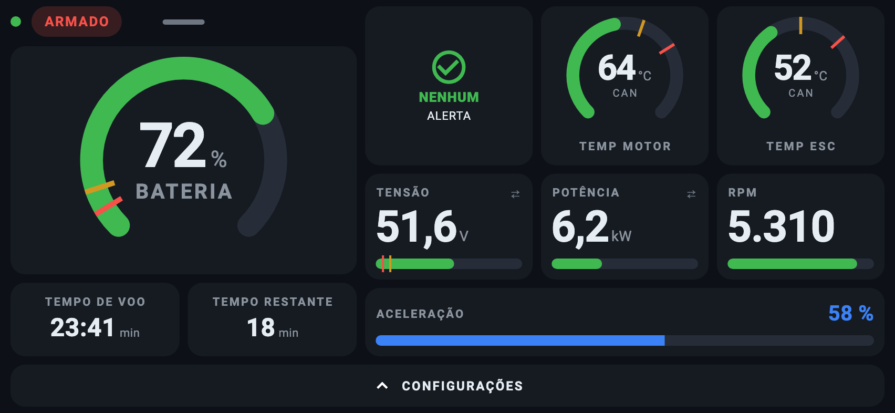 
  <em>Figura 4: Painel de voo na horizontal</em>

### Alertas

Os alertas aparecem sempre no cartão de alerta, nunca em faixas ou janelas. A cor indica a gravidade: cinza para informação, âmbar para atenção, vermelho para perigo. Fundo vermelho indica que o motor foi desarmado por uma falha.

  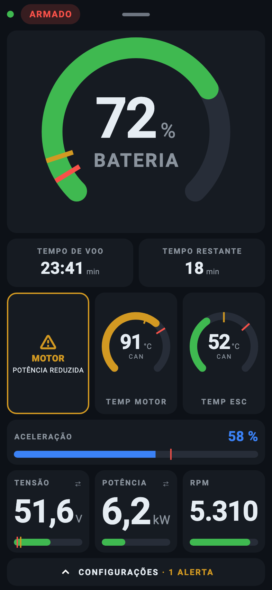 
  <em>Figura 5: Motor quente: potência reduzida a 64 %</em>

| Alerta | Quando aparece |
|---|---|
| **MOTOR ou ESC · SUPERAQUECIDO** | Passou da temperatura máxima e a potência foi cortada. Alivie o acelerador. |
| **MOTOR ou ESC · POTÊNCIA REDUZIDA** | Está na faixa de redução e o controlador limitou a potência. |
| **MOTOR ou ESC · ACIMA DO LIMITE** | Passou do início da redução com o Controle de Energia desligado. O controlador não vai reduzir a potência sozinho. |
| **BATERIA · POTÊNCIA REDUZIDA** | A tensão está baixa e o controlador limitou a potência. |
| **POTÊNCIA · LIMITADA** | O controlador limitou a potência sem informar a causa. |
| **BATERIA · CRÍTICA** | Carga em 5 % ou menos. Pouse agora. |
| **BATERIA · BAIXA** | Carga em 10 % ou menos. Planeje o pouso. |
| **MOTOR ou ESC · SEM SENSOR, BATERIA · SEM TENSÃO** | Com o sistema desarmado, o sensor não está dando leitura válida. Confira o cabo antes de armar. |
| **ESC · SEM DADOS** | O controlador não recebe dados do ESC. Confira o cabo de dados. |
| **BATERIA · SEM BMS** | Há um BMS configurado, mas a conexão com ele caiu. |
| **MOTOR ou ESC · PERTO DO LIMITE** | A temperatura está a até 10 °C do início da redução. |

O cartão de alerta pode ficar âmbar com os mostradores ainda verdes: ele também reflete a limitação que o próprio controlador informa.

### Desarme por falha

Quando o controlador desarma por falha, o código aparece em vermelho na barra de status e o cartão de alerta fica vermelho, com o componente e o problema. Os dois ficam até o próximo armamento.

  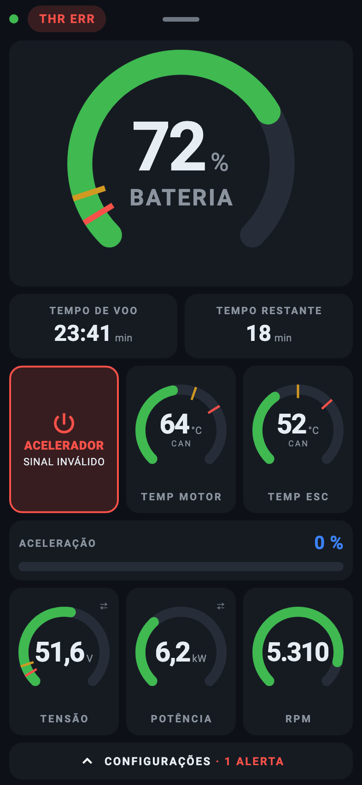 
  <em>Figura 6: Desarme por falha do acelerador (THR ERR)</em>

| Código | Alerta | Causa |
|---|---|---|
| **THR ERR** | ACELERADOR · SINAL INVÁLIDO | Leitura do acelerador com fio fora da faixa calibrada ou falha do ADS1115. |
| **LINK ERR** | ACELERADOR · SEM SINAL | Remote sem sinal por mais de 3 segundos. |
| **BATT ERR** | BATERIA · SEM TENSÃO | Sensor de tensão inválido por 2 segundos durante o voo. |

Firmwares anteriores também podiam desarmar por falha de temperatura, com os códigos MOT ERR, ESC ERR e MOT SRC. No firmware atual a perda de temperatura gera alarme, não desarme.

### Leitura ausente

Uma leitura sem valor confiável mostra um traço, nunca zero, com o motivo abaixo dele: DESATUALIZADO, INVÁLIDO ou SEM SENSOR. Potência, corrente e RPM mostram SEM DADOS quando o ESC não envia dados. O cartão continua no lugar.

  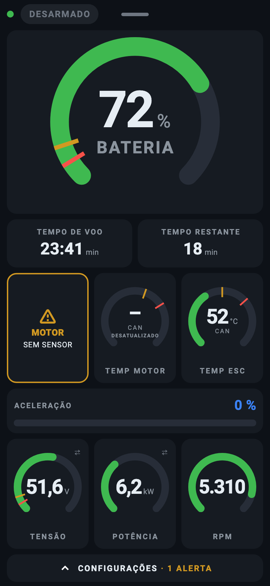 
  <em>Figura 7: Temperatura do motor sem leitura</em>

### Perda de conexão

Se os dados param de chegar por 3 segundos, todos os valores viram traço e a barra de status mostra **RECONECTANDO** enquanto o app tenta reconectar, ou **SEM SINAL**. O app reconecta sozinho e nunca volta por conta própria para a tela inicial.

  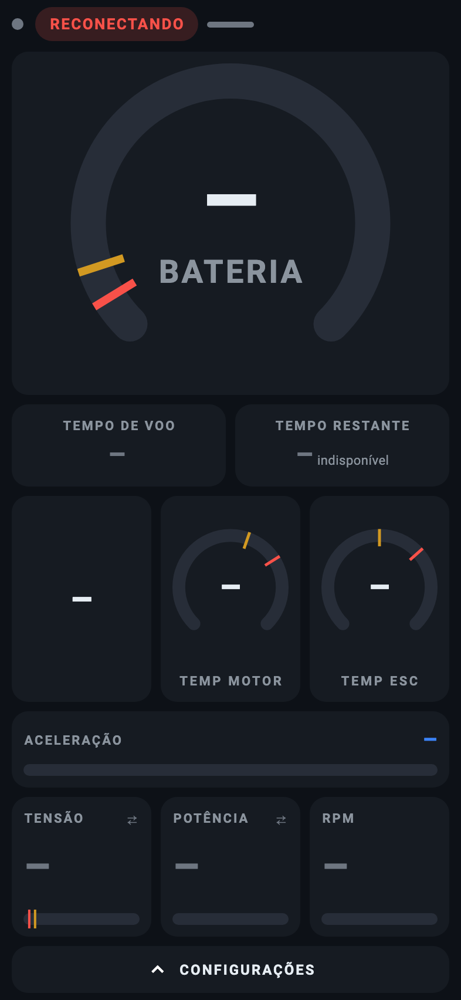 
  <em>Figura 8: Conexão perdida, app reconectando</em>

Toque no indicador de status para escolher: **Reconectar** tenta de novo sem sair do painel; **Desconectar** volta para a tela inicial. Se o último dado dizia ARMADO, o app avisa. Desconectar o app não desliga o motor.

  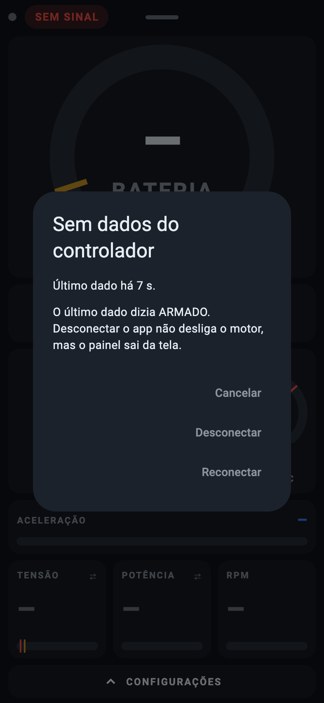 
  <em>Figura 9: Toque no indicador de status: Reconectar ou Desconectar</em>

### Gaveta

Toque na barra CONFIGURAÇÕES no rodapé, ou no cartão de alerta, para abrir a gaveta:

- **Alertas ativos:** cada alerta com uma explicação do que fazer.
- **Som do controlador:** o celular reproduz os beeps do buzzer, inclusive com o celular no silencioso, sem interromper outro app de áudio (como o vario do XCTrack). Começa ligado sempre que o app abre.
- **Orientação da tela:** Vertical, Horizontal ou Automático (só no app instalado).
- **Configurações:** abre as configurações do controlador. Fica indisponível com a aeronave armada.

  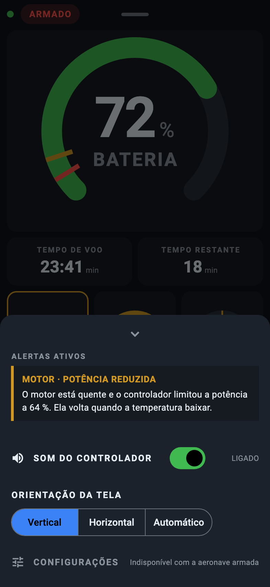 
  <em>Figura 10: Gaveta: alertas, som, orientação e configurações</em>

### Detalhes

Arraste a barra de status para baixo, até cerca de 40 % da altura da tela, para abrir os detalhes. Os valores continuam atualizando. Volte com o botão VOLTAR AO PAINEL ou arrastando a barra de baixo para cima.

- **Bateria:** carga por contagem e por tensão, tensão, corrente, tensão por célula e sua origem, células mínima e máxima, diferença entre células, estado e leituras do BMS.
- **Motor e ESC:** temperatura, sensor e seu estado, RPM, pontos de redução e máximo.
- **Acelerador:** aceleração, leitura bruta e potência disponível.
- **Sistema:** horímetro, tempo ligado, versão do firmware, origem dos dados e quadros rejeitados.

  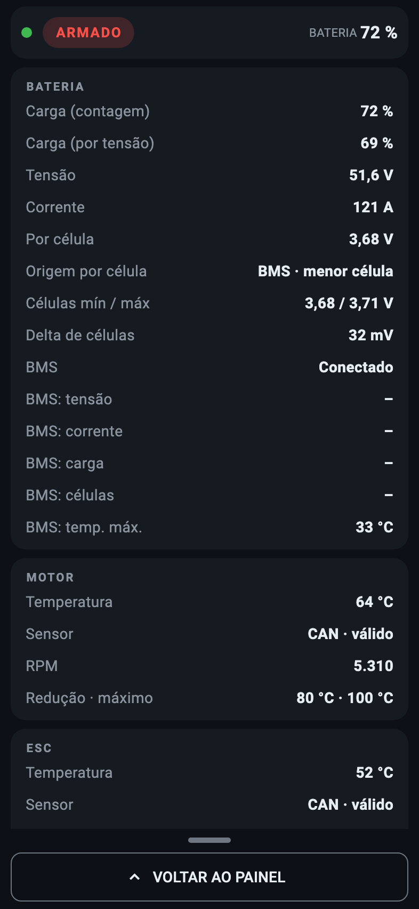 
  <em>Figura 11: Tela de detalhes</em>

## Configurações

Abra pela gaveta, em Configurações, com a aeronave desarmada. O topo mostra a versão do firmware e o tipo de controlador. Enquanto a aeronave estiver armada, nada pode ser gravado.

  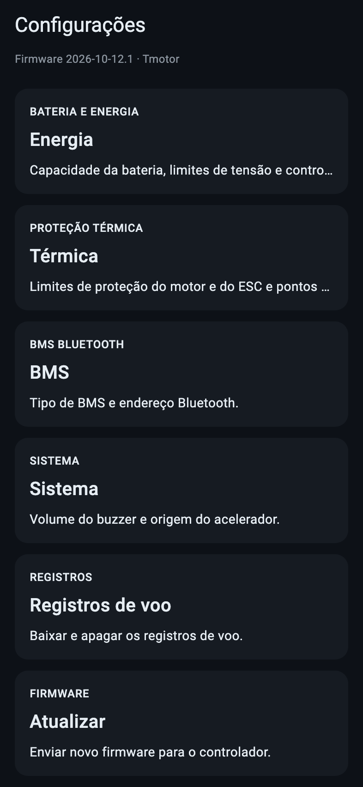 
  <em>Figura 12: Índice de configurações</em>

### PIN de configuração

Ver as configurações não pede PIN. O PIN é pedido na primeira gravação de cada conexão e não fica guardado no celular. O PIN de fábrica é **0000**; troque-o em Sistema, na seção Segurança.

  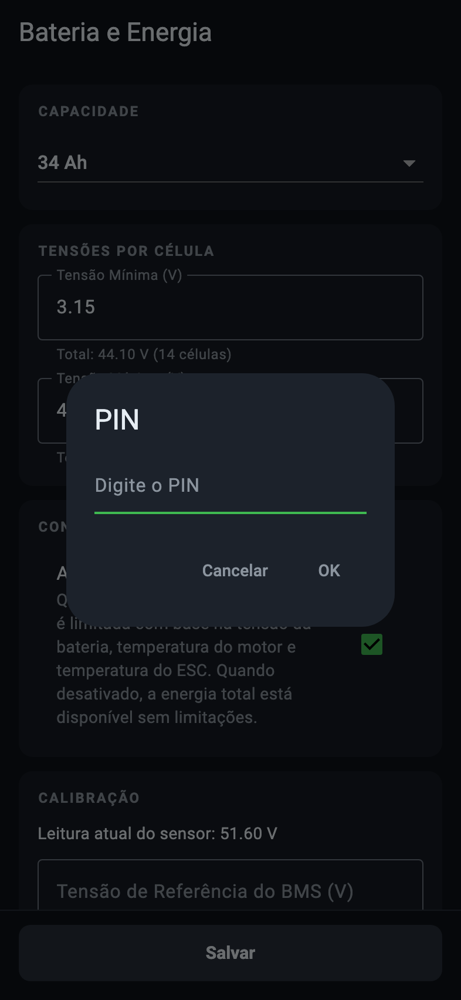 
  <em>Figura 13: Pedido do PIN na primeira gravação</em>

| Ação | Pede PIN |
|---|---|
| **Painel de voo, alertas e detalhes** | Não |
| **Ver configurações** | Não |
| **Gravar configurações** | Sim |
| **Buscar BMS, parear ou esquecer remote** | Sim |
| **Zerar o cronômetro de voo** | Sim |
| **Listar e baixar registros** | Não |
| **Apagar registros** | Sim |
| **Atualizar o firmware** | Sim |

O relógio do controlador é acertado pelo app automaticamente a cada conexão, com o sistema desarmado, para que os registros recebam a data do voo. Isso não pede PIN.

### Bateria e Energia

  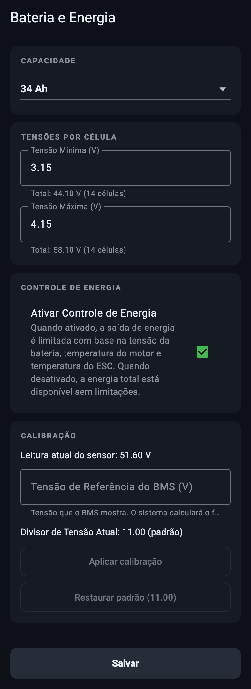 
  <em>Figura 14: Bateria e Energia</em>

| Parâmetro | Descrição | Faixa |
|---|---|---|
| **Capacidade** | 18, 34 ou 65 Ah, ou um valor personalizado. Com um BMS JBD ou JK conectado, o controlador usa a capacidade informada pelo BMS no lugar desta. | 1 a 65 Ah |
| **Tensão mínima** | Por célula. Abaixo dela, a potência é reduzida. O app mostra o total do pack (14 células). | 2,5 a 63,0 V no pack |
| **Tensão máxima** | Por célula. Referência de bateria cheia. | 2,5 a 63,0 V no pack |
| **Ativar Controle de Energia** | Liga ou desliga a limitação de potência por tensão e temperaturas. Desligado, a potência total fica sempre disponível. | Ligado ou desligado |

A tensão mínima precisa ser menor que a máxima. Os campos aceitam vírgula ou ponto como separador decimal.

Com um BMS JBD ou JK conectado, o controlador usa a capacidade que o BMS informa: alguns segundos depois da conexão, com o sistema desarmado, ela passa a valer para o cálculo da carga, mantendo a porcentagem atual. O valor configurado no app não é alterado e volta a valer quando não houver BMS informando a capacidade. Se o BMS informar mais de 65 Ah, vale o valor configurado. O BMS Daly não informa a capacidade, então ela continua manual.

**Calibração** (quando o controlador tem sensor de tensão):

- Mostra a leitura atual do sensor e o divisor de tensão em uso.
- Digite a tensão que o BMS mostra em Tensão de Referência do BMS. O app calcula o novo divisor; toque em Aplicar calibração.
- Restaurar padrão volta ao divisor de fábrica (disponível em firmwares que informam esse valor).

### Proteção Térmica

  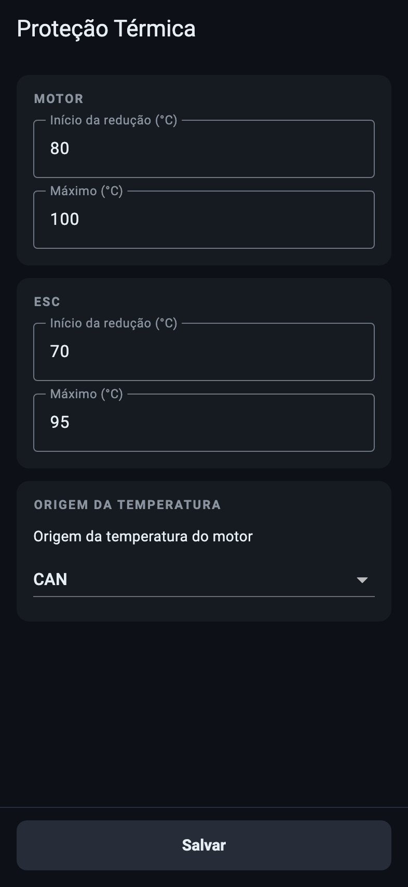 
  <em>Figura 15: Proteção Térmica</em>

| Parâmetro | Descrição | Faixa |
|---|---|---|
| **Motor: início da redução** | A partir desta temperatura, a potência começa a ser reduzida. | 0 a 150 °C |
| **Motor: máximo** | Nesta temperatura, a potência é cortada. | 0 a 150 °C |
| **ESC: início da redução** | A partir desta temperatura, a potência começa a ser reduzida. | 0 a 150 °C |
| **ESC: máximo** | Nesta temperatura, a potência é cortada. | 0 a 150 °C |
| **Origem da temperatura do motor** | CAN ou NTC. Aparece só nos controladores que permitem escolher. | CAN ou NTC |

A redução é linear entre o início e o máximo. O início precisa ser menor que o máximo: valores iguais ou invertidos cortariam a potência a partir do início, e o app recusa gravá-los.

Esses valores são os traços âmbar e vermelho dos mostradores de temperatura no painel.

### BMS

  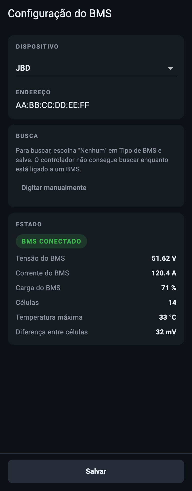 
  <em>Figura 16: BMS configurado e conectado</em>

| Parâmetro | Descrição |
|---|---|
| **Tipo de BMS** | Nenhum, JBD, Daly (D2 BLE) ou JK BMS. |
| **Endereço** | Endereço Bluetooth do BMS (AA:BB:CC:DD:EE:FF), escolhido pela busca ou digitado em Digitar manualmente. |

A seção Estado mostra a conexão com o BMS e, quando conectado, a tensão, a corrente, a carga, o número de células, a temperatura máxima e a diferença entre células.

**Busca:** o botão Buscar BMS só aparece quando o tipo gravado é Nenhum, porque o controlador não consegue buscar enquanto está ligado a um BMS. Para trocar de BMS, escolha Nenhum, salve e então busque. A busca leva 5 segundos; durante esse tempo o controlador não aparece para novas conexões.

  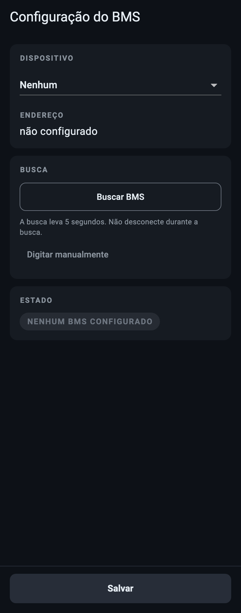 
  <em>Figura 17: BMS: busca disponível sem BMS configurado</em>

Toque num resultado para preencher o endereço. Se o BMS se identificou, o tipo também é preenchido; senão, escolha o tipo na lista. Quando há muitos dispositivos, a lista mostra "Mostrando N de M".

### Sistema

  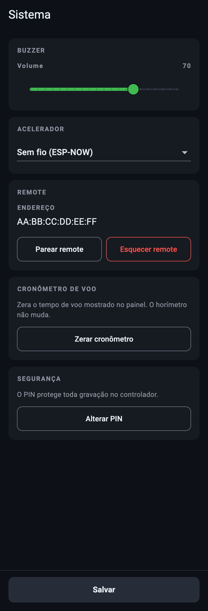 
  <em>Figura 18: Sistema: buzzer, acelerador, remote, cronômetro e PIN</em>

| Parâmetro | Descrição | Padrão |
|---|---|---|
| **Volume do buzzer** | De 0 a 100 %, em passos de 5 %. Ao soltar o controle, o buzzer toca uma amostra. | 85 % |
| **Acelerador** | Cabeado ou Sem fio (ESP-NOW): de onde vêm o acelerador e o botão. | — |

**Remote** (acelerador sem fio): mostra o endereço do remote pareado ou NÃO PAREADO.

- **Parear remote:** toque e ligue o remote. O app espera 60 segundos. Se nenhum remote aparecer, o controlador continua aguardando, e o próximo remote ligado por perto será pareado.
- **Esquecer remote:** apaga o endereço gravado. Um remote já em uso pode continuar funcionando até o controlador reiniciar.

**Cronômetro de voo:** Zerar cronômetro volta o tempo de voo do painel a 00:00. O horímetro não muda.

**Segurança:** Alterar PIN pede o PIN atual e o novo duas vezes. O PIN tem de 4 a 8 caracteres, entre letras sem acento, números e símbolos.

### Registros de voo

Lista os registros gravados no controlador, do mais recente para o mais antigo, com a data e o número do voo do dia, e o espaço ocupado na memória.

  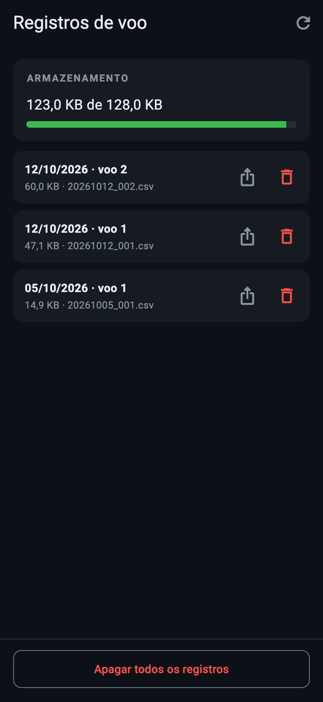 
  <em>Figura 19: Registros de voo</em>

- Toque no ícone de compartilhar para baixar o registro (CSV) e enviá-lo pela folha de compartilhamento do celular. No navegador, escolha Compartilhar, Salvar arquivo ou Abrir.
- Toque na lixeira para apagar um registro, ou em Apagar todos os registros.
- Com a aeronave armada, a tela fica indisponível.

### Atualização de firmware

No app para Android, a tela compara o firmware do controlador com a versão mais recente publicada no GitHub. Se houver uma mais nova, oferece baixar a imagem do tipo do seu controlador (T-Motor ou XAG). Também é possível escolher um arquivo .bin.

  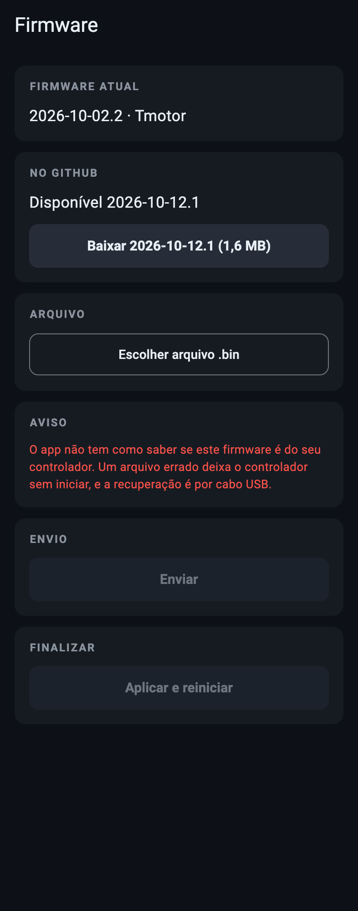 
  <em>Figura 20: Firmware: nova versão disponível no GitHub</em>

1. Toque em **Baixar** (ou em **Escolher arquivo .bin**).
2. Leia o aviso. O app não tem como garantir que a imagem é do seu controlador; um arquivo errado deixa o controlador sem iniciar, e a recuperação é por cabo USB.
3. Toque em **Enviar** e aguarde. A tela mostra o progresso e o tempo restante.
4. Quando aparecer Pronto para aplicar, toque em **Aplicar e reiniciar**. O controlador reinicia com o firmware novo.

O envio só é possível com a aeronave desarmada. Se algo falhar, a tela mostra o motivo e um diagnóstico com cada passo; o firmware antigo continua funcionando. A atualização também pode ser feita por cabo USB.
